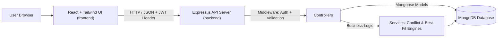
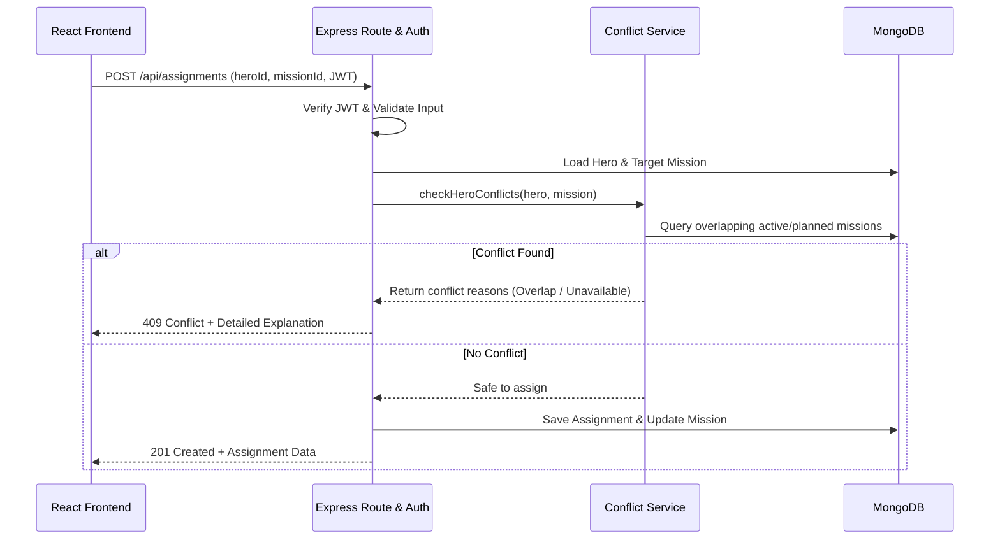
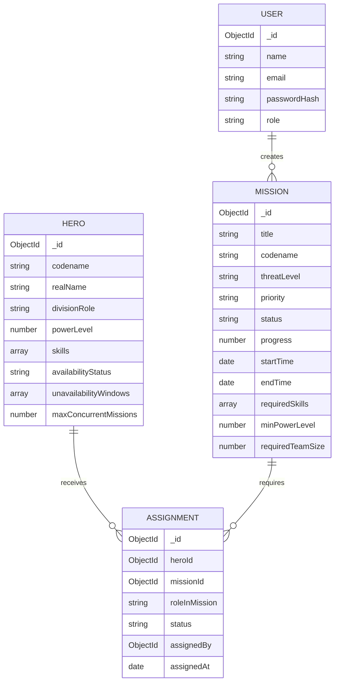

# Baxter Building — Fantastic Force
### NEXUS PROTOCOL: EVERY CRISIS HAS A RESPONSE.
#### Complete MERN Stack Architecture, Project Structure & Beginner-Friendly Roadmap

---

## 1. Project Overview

**Baxter Building - Fantastic Force** (**Nexus Command Center**) is a futuristic superhero mission and resource management web application built around the **Cyberpunk Nexus** command interface. Think of it as a reliable, intelligent **Emergency Operations Center** where commanders and operators manage heroes, coordinate responses, prevent scheduling clashes, and match the best squad to any crisis.

### What Problem Does It Solve?
Managing a superhero roster during simultaneous emergencies is hard if done manually:
- Two missions might accidentally book the same hero at the exact same time (**Conflict Detection** stops this).
- A commander might not know which hero has the right skills and workload capacity for a threat (**Squad Sync Engine** / Best-Fit Recommendations ranks heroes automatically).
- Heroes need downtime after tough missions (**Hero Network** & Availability Management tracks status and recovery windows).
- Leadership needs real-time operational visibility (**Threat Intelligence** computes live stats from the database — never fake/hardcoded numbers, alongside **Vanguard Leaderboard** and **Signal Hub**).

### How the MERN Stack Works Together (Beginner Summary)
| Letter | Technology | Role in Simple Words |
| :--- | :--- | :--- |
| **M** | **MongoDB** | The digital filing cabinet (NoSQL database) that stores Heroes, Missions, Users, and Assignments permanently. |
| **E** | **Express.js** | The traffic controller on the backend that receives requests from the website, checks permissions, and runs logic. |
| **R** | **React.js** | The interactive control screen (frontend UI) that the user sees and clicks in the browser. |
| **N** | **Node.js** | The engine that runs JavaScript on the server (outside the browser) so Express and MongoDB can work. |

> **Golden Rule:** Our **Frontend (`frontend/`)** and **Backend (`backend/`)** live in separate folders and communicate strictly through a REST API (JSON data over HTTP). The React frontend never touches the database directly!

---

## 2. Technology Stack & Learning Resources

### Core Stack
- **Frontend:**
  - **React.js (Vite)** — Fast modern React bundler and dev server.
  - **Tailwind CSS** — Utility-first CSS framework for building our dark command-center UI cleanly.
  - **React Router DOM** — Handles multi-page navigation (Dashboard, Heroes, Missions, Assignments) without reloading the page.
  - **Axios** — Sends HTTP requests to the backend API and automatically attaches our JWT login token.
  - **Lucide React** — Clean, futuristic vector icons.
- **Backend:**
  - **Node.js (LTS)** & **Express.js** — REST API server and routing.
  - **MongoDB** & **Mongoose** — Database + structured schemas/validation in JavaScript.
  - **JSON Web Tokens (`jsonwebtoken`)** — Secure stateless login tokens so the server remembers who you are.
  - **`bcryptjs`** — Scrambles (hashes) passwords so plain-text passwords are never stored in the database.
  - **`zod` (or `express-validator`)** — Validates every incoming request body before touching the database.
  - **`helmet`, `cors`, `express-rate-limit`** — Essential web security protections.
  - **`dotenv`** — Loads secret keys (like database URI and JWT secret) from a hidden `.env` file.
- **Testing & Quality:**
  - **Jest** + **Supertest** — Automated backend unit and API endpoint testing.
  - **`mongodb-memory-server`** (for tests) — Runs a temporary in-memory MongoDB during tests so tests never corrupt real data.
  - **Vitest** + **React Testing Library** — Automated UI component testing.

### Recommended Official Resources (Beginner-Friendly)
| Topic | Resource | Why Read It |
| :--- | :--- | :--- |
| JavaScript & React | [react.dev/learn](https://react.dev/learn) | Best beginner guide to components, props, and state (`useState`, `useEffect`). |
| Styling UI | [tailwindcss.com/docs](https://tailwindcss.com/docs) | Look up utility classes (`bg-slate-950`, `text-amber-400`, `grid`, `flex`). |
| Node & Express | [expressjs.com](https://expressjs.com/en/starter/installing.html) | Understand routes, middleware, and `req` / `res` objects. |
| MongoDB & Mongoose | [mongoosejs.com/docs/guide.html](https://mongoosejs.com/docs/guide.html) | Learn how schemas, models, and queries (`find`, `create`, `aggregate`) work. |
| JWT Auth | [jwt.io/introduction](https://jwt.io/introduction) | Visual explanation of how Header.Payload.Signature tokens work. |
| Local Tools | Node.js LTS, MongoDB Community Server, MongoDB Compass (GUI) | Compass lets you visually inspect your database tables/collections! |

---

## 3. System Architecture

### High-Level Architecture Diagram



### How a Request Flows (Step-by-Step)
1. **User Action:** You click **"Assign Hero"** in React.
2. **API Call:** Axios sends `POST /api/assignments` with `{ heroId, missionId }` and your `Authorization: Bearer <token>` header.
3. **Security Gate (Middleware):**
   - `authMiddleware` verifies the JWT token.
   - `roleMiddleware` checks if you have permission (`commander` or `operator`).
   - `validateMiddleware` checks that `heroId` and `missionId` are valid MongoDB IDs.
4. **Conflict Check (Service):** `conflictService` checks the database to verify the hero isn't already booked during that mission's time window, isn't recovering/unavailable, and hasn't exceeded `maxConcurrentMissions`.
5. **Database Save:** If clear, Mongoose creates the `Assignment` record and updates the mission's assigned roster.
6. **Response:** Express returns HTTP `201 Created` with the updated assignment; React refreshes the UI smoothly.

### Mission Assignment & Conflict Detection Sequence



---

## 4. Complete Project Folder & File Structure

Keeping the frontend and backend in clean, predictable folders makes debugging easy as the app grows.

```text
baxter-building-fantastic-force/
│
├── PROJECT_ROADMAP.md              # This master architecture & roadmap guide
├── .gitignore                      # Ignores node_modules, .env files, and build artifacts
│
├── backend/                        # ================= BACKEND (Node + Express + MongoDB) =================
│   ├── package.json                # Backend dependencies & scripts (dev, start, test, seed)
│   ├── .env.example                # Safe template showing required env vars (NO real secrets!)
│   ├── .env                        # Actual local secrets (NEVER commit to Git!)
│   │
│   └── src/
│       ├── server.js               # Entry point: connects to MongoDB and starts HTTP server
│       ├── app.js                  # Configures Express, CORS, Helmet, JSON parser, and routes
│       │
│       ├── config/
│       │   ├── db.js               # MongoDB connection helper with clean error logging
│       │   └── env.js              # Validates required environment variables on startup
│       │
│       ├── models/                 # Mongoose schemas (shape of data in MongoDB)
│       │   ├── User.js             # Commander & Operator accounts (hashed passwords, roles)
│       │   ├── Hero.js             # Hero profiles, skills, powerLevel, availability & windows
│       │   ├── Mission.js          # Missions, threatLevel, time window, requiredSkills, logs
│       │   └── Assignment.js       # Links a Hero to a Mission with role & assignment status
│       │
│       ├── middleware/             # Functions that run BEFORE controllers
│       │   ├── authMiddleware.js   # Verifies JWT token & attaches req.user
│       │   ├── roleMiddleware.js   # Restricts routes to specific roles (e.g., commander only)
│       │   ├── validate.js         # Runs Zod/validator schemas on req.body / req.params
│       │   └── errorHandler.js     # Central error handler (returns clean JSON errors)
│       │
│       ├── services/               # Reusable business logic (the "brains" of the app)
│       │   ├── conflictService.js  # Detects schedule overlaps, capacity limits, & downtime
│       │   ├── recommendService.js # Scores & ranks Best-Fit heroes with explanation tags
│       │   └── analyticsService.js # Runs live MongoDB aggregations for the Dashboard
│       │
│       ├── controllers/            # Connects HTTP routes to services/models
│       │   ├── authController.js
│       │   ├── heroController.js
│       │   ├── missionController.js
│       │   ├── assignmentController.js
│       │   └── dashboardController.js
│       │
│       ├── routes/                 # URL endpoint definitions
│       │   ├── authRoutes.js       # /api/auth/*
│       │   ├── heroRoutes.js       # /api/heroes/*
│       │   ├── missionRoutes.js    # /api/missions/*
│       │   ├── assignmentRoutes.js # /api/assignments/*
│       │   └── dashboardRoutes.js  # /api/dashboard/*
│       │
│       ├── validators/             # Input validation rules (prevent bad/malicious data)
│       │   ├── authValidator.js
│       │   ├── heroValidator.js
│       │   ├── missionValidator.js
│       │   └── assignmentValidator.js
│       │
│       ├── scripts/
│       │   └── seedAdmin.js        # Optional CLI script to create an initial Commander account
│       │
│       └── tests/                  # Automated backend tests (Jest + Supertest)
│           ├── conflictService.test.js
│           ├── recommendService.test.js
│           ├── auth.integration.test.js
│           └── assignment.integration.test.js
│
└── frontend/                       # ================= FRONTEND (React + Vite + Tailwind) =================
    ├── package.json                # Frontend dependencies & scripts (dev, build, test)
    ├── index.html                  # Root HTML shell with Inter font
    ├── tailwind.config.js          # Cyberpunk Nexus palette, spacing & accessible animations
    ├── .env.example                # VITE_API_URL=http://localhost:5000/api
    │
    └── src/
        ├── main.jsx                # Mounts React app into index.html
        ├── App.jsx                 # Top-level Nexus routes & AuthProvider wrapper
        ├── index.css               # Tailwind directives + reduced-motion & restrained glow utilities
        │
        ├── api/                    # Axios setup & API endpoint helpers
        │   ├── axiosClient.js      # Base URL + attaches JWT token + handles 401 expiry
        │   ├── authApi.js
        │   ├── heroApi.js
        │   ├── missionApi.js
        │   ├── assignmentApi.js
        │   └── dashboardApi.js
        │
        ├── context/
        │   └── AuthContext.jsx     # Global login state (user, token, login, logout)
        │
        ├── data/
        │   └── emergencies.js      # Definitions for the 5 core emergency response types
        │
        ├── components/             # Reusable UI building blocks
        │   ├── ui/                 # Pure design-system primitives
        │   │   ├── Button.jsx
        │   │   ├── Card.jsx
        │   │   ├── Badge.jsx       # Threat/status pills (Available, Critical, Omega)
        │   │   ├── Modal.jsx
        │   │   ├── Input.jsx
        │   │   ├── Select.jsx
        │   │   ├── StatCard.jsx    # KPI metric card with subtle cyan/violet glow
        │   │   ├── EmptyState.jsx
        │   │   └── Spinner.jsx
        │   │
        │   ├── layout/             # App shell & navigation
        │   │   ├── Navbar.jsx       # Baxter emblem, Nexus nav links, Signal Hub & Profile
        │   │   ├── CommandShell.jsx # Responsive shell wrapping all Nexus pages
        │   │   └── ProtectedRoute.jsx
        │   │
        │   ├── home/               # Stage 1: Nexus Command Center Homepage
        │   │   ├── SkylineBackdrop.jsx    # Dark futuristic skyline + Baxter Building tower
        │   │   ├── EmergencyCards.jsx     # 5 interactive emergency selection cards
        │   │   └── EmergencyBriefing.jsx  # Transition scene, requirements & Create Mission CTA
        │   │
        │   ├── heroes/             # Hero Network UI components
        │   │   ├── HeroCard.jsx
        │   │   ├── HeroFormModal.jsx
        │   │   └── AvailabilityWindowModal.jsx
        │   │
        │   └── missions/           # Mission Control & Squad Sync UI components
        │       ├── MissionCard.jsx
        │       ├── MissionFormModal.jsx
        │       ├── ConflictAlert.jsx       # Explains scheduling/availability clashes clearly
        │       ├── RecommendationPanel.jsx # Squad Sync Engine: Best-Fit scores & 1-click Assign
        │       └── MissionTimeline.jsx     # Live progress bar & tactical log updates
        │
        ├── pages/                  # Full screens mapped to routes
        │   ├── HomePage.jsx              # Stage 1: Nexus Command Center Homepage
        │   ├── LoginPage.jsx
        │   ├── RegisterPage.jsx
        │   ├── ThreatIntelligencePage.jsx # Real-backend analytics & workload metrics
        │   ├── HeroNetworkPage.jsx       # Hero profiles, skills & availability
        │   ├── MissionControlPage.jsx    # Active & pending mission board
        │   ├── MissionDetailPage.jsx     # Tracking, Squad Sync & conflict detection
        │   ├── MissionArchivesPage.jsx   # Completed & historical operations
        │   ├── VanguardLeaderboardPage.jsx # Hero rankings & historical performance
        │   ├── SignalHubPage.jsx         # Assignments, updates & deadline alerts
        │   └── AvailabilityPage.jsx
        │
        └── utils/
            ├── formatDate.js       # Clean date/time formatting helpers
            └── statusStyles.js     # Maps statuses/threats to consistent Tailwind colors
```

---

## 5. Database Design (MongoDB & Mongoose)

### Entity Relationship Diagram



### Key Schema Details
1. **User:**
   - `role`: `"commander"` | `"operator"` (first registered user automatically becomes `"commander"`, or created via `seedAdmin.js`; subsequent self-registered users default to `"operator"`).
   - `passwordHash`: stored via `bcryptjs` (`select: false` in Mongoose so queries never accidentally return password hashes).
2. **Hero:**
   - `skills`: array of `{ name: String, level: Number (1-10) }` (e.g., `[{ name: "Energy Projection", level: 9 }, { name: "Tactics", level: 8 }]`).
   - `availabilityStatus`: `"available"` | `"on_mission"` | `"recovering"` | `"unavailable"`.
   - `unavailabilityWindows`: array of `{ startTime: Date, endTime: Date, reason: String }` for scheduled maintenance, medical recovery, or off-world leave.
   - `maxConcurrentMissions`: default `1` (prevents double-booking unless explicitly configured higher).
3. **Mission:**
   - `threatLevel`: `"low"` | `"moderate"` | `"high"` | `"omega"`.
   - `priority`: `"routine"` | `"urgent"` | `"critical"`.
   - `status`: `"planned"` | `"active"` | `"completed"` | `"aborted"` | `"failed"`.
   - `progress`: integer `0` to `100`.
   - `timelineLogs`: array of `{ message: String, createdBy: ObjectId, createdAt: Date }` for real-time mission tracking.
4. **Assignment:**
   - Normalized collection linking `heroId` and `missionId` with `status`: `"active"` | `"released"` | `"completed"`.
   - Having a dedicated `Assignment` model makes conflict queries, audit history, and hero utilization analytics fast and reliable.

---

## 6. Core Features & Intelligence Logic

### A. Conflict Detection Engine (`conflictService.js`)
Before assigning a hero to a mission (or updating a mission's time window), the backend runs **4 automated safety checks**:
1. **Hero Status Check:** Is the hero `"recovering"` or `"unavailable"`? If yes, block assignment with a clear warning.
2. **Time-Window Blackout Check:** Does the mission's `[startTime, endTime]` overlap any of the hero's `unavailabilityWindows`?
   - **Overlap Formula:** Two time ranges $[A_{start}, A_{end}]$ and $[B_{start}, B_{end}]$ overlap if:
     $$A_{start} < B_{end} \quad \text{AND} \quad A_{end} > B_{start}$$
3. **Mission Schedule Overlap & Capacity Check:** Find all `"active"` assignments for that hero whose missions have status `"planned"` or `"active"` and overlap `[startTime, endTime]`.
   - If overlapping count $\ge$ `hero.maxConcurrentMissions`, return a **Schedule Conflict** naming the exact conflicting mission!
4. **Duplicate Assignment Check:** Prevent assigning the same hero twice to the same mission.

> **Why Both Frontend & Backend?** The frontend calls a `/preview-conflicts` endpoint so you see warnings *before* clicking Assign, and the backend enforces the exact same check inside `POST /api/assignments` so invalid assignments can never slip through.

### B. Best-Fit Recommendation Engine (`recommendService.js`)
When viewing a mission, the system evaluates every hero in the database and calculates a **0–100 Fit Score** using transparent weights:
1. **Skill Match (up to 45 points):** Percentage of `mission.requiredSkills` the hero possesses, weighted by whether their skill level meets `minLevel`.
2. **Power Suitability (up to 25 points):** Compares `hero.powerLevel` against `mission.minPowerLevel` (rewards meeting or slightly exceeding requirements without wasting an Omega-level hero on a routine patrol if avoidable).
3. **Availability & Conflict-Free Status (up to 20 points):** Full points if `"available"` with zero conflicts; heavy penalty or flagged warning if conflicted/recovering.
4. **Workload Balance (up to 10 points):** Favors heroes with fewer currently active/upcoming missions so one hero isn't overworked.

Each recommendation returns:
- `fitScore` (0–100)
- `reasons` (e.g., `["Matches 3/3 required skills", "Power level exceeds minimum (88 vs 70)", "Zero schedule conflicts"]`)
- `conflicts` (empty if clear, or exact conflict warning if unavailable)

---

## 7. REST API Endpoints Blueprint

| Module | Method & Endpoint | Access | Purpose |
| :--- | :--- | :--- | :--- |
| **Auth** | `POST /api/auth/register` | Public | Register user (first user becomes `commander`, others `operator`) |
| **Auth** | `POST /api/auth/login` | Public | Verify credentials & return JWT token |
| **Auth** | `GET /api/auth/me` | Protected | Return current logged-in user profile |
| **Heroes** | `GET /api/heroes` | Protected | List heroes with search, skill, & availability filters |
| **Heroes** | `POST /api/heroes` | Commander | Create a new hero |
| **Heroes** | `PATCH /api/heroes/:id` | Commander | Update hero stats, skills, or status |
| **Heroes** | `POST /api/heroes/:id/unavailability` | Protected | Add a recovery/blackout window |
| **Heroes** | `DELETE /api/heroes/:id` | Commander | Remove a hero (only if no active mission conflict) |
| **Missions** | `GET /api/missions` | Protected | List missions with status, threat, & priority filters |
| **Missions** | `POST /api/missions` | Commander | Create a new mission |
| **Missions** | `GET /api/missions/:id` | Protected | Full mission details, assigned heroes, and timeline logs |
| **Missions** | `PATCH /api/missions/:id/tracking` | Protected | Update status, progress (0–100%), and add a tactical log |
| **Missions** | `DELETE /api/missions/:id` | Commander | Delete a planned/cancelled mission |
| **Assignments** | `POST /api/assignments/check` | Protected | Preview conflicts without saving |
| **Assignments** | `POST /api/assignments` | Protected | Assign hero to mission (enforces conflict detection) |
| **Assignments** | `DELETE /api/assignments/:id` | Protected | Release/unassign a hero from a mission |
| **Intelligence** | `GET /api/missions/:id/recommendations` | Protected | Ranked Best-Fit hero recommendations with scores & reasons |
| **Dashboard** | `GET /api/dashboard/analytics` | Protected | Live MongoDB aggregations (counts, utilization, upcoming timeline) |

---

## 8. UI/UX Design Guidelines ("Cyberpunk Nexus — Command Center")

### Color System (Void Black, Midnight Navy, Cyan, Violet & Emergency Accents)
| Token | Hex | Usage |
| :--- | :--- | :--- |
| **Void Black** | `#080D19` | Main page canvas background |
| **Midnight Navy** | `#111B31` | Header, navigation drawers, secondary panels |
| **Card Background** | `#17243B` | Interactive cards, modals, elevated containers |
| **Electric Cyan** | `#16D9F5` | Primary actions, Tech Crisis, active navigation |
| **Neon Violet** | `#9B5CFF` | Secondary accents, City Under Attack |
| **Emergency Orange** | `#FF7139` | Fire Emergency & fire-related emergency states |
| **Success Green** | `#32C98A` | Medical Emergency & success/completed states |
| **Primary Text** | `#F4F7FC` | Main headings and high-contrast values |
| **Secondary Text** | `#A9B5C9` | Supporting copy, timestamps, secondary labels |

### UX & Component Principles
- **Calm, Reliable Operations Feel:** Clean `Inter` typography, subtle borders, restrained neon glow, generous spacing, and high color contrast—avoiding visual clutter or tiny unreadable text.
- **Stage 1 Homepage Priority (`Nexus Command Center`):** Features the dark futuristic skyline + Baxter Building tower, *"EVERY CRISIS HAS A SOLUTION. WE'RE READY TO RESPOND."*, and 5 interactive, keyboard-accessible emergency selection cards (Fire Emergency, Flood Rescue, City Under Attack, Medical Emergency, Tech Crisis) with lightweight `prefers-reduced-motion`-safe selection transitions.
- **Responsive Shell:** Clean top navigation bar on desktop with mobile/tablet collapsible drawer and accessible keyboard navigation.
- **Reusable Primitives (`components/ui/`):** Build `Card`, `Button`, `Badge`, `Modal`, `StatCard`, and `Input` once and reuse everywhere.
- **Zero Fake Data:** If the database is empty (or a module is awaiting backend connection), show honest empty/status states rather than fabricated production telemetry.

---

## 9. Step-by-Step Build Roadmap (Feature by Feature)

We build **one feature/module at a time** and keep the project runnable and verified at every stage.

### Stage 1 (Current Priority) — Nexus Command Center Homepage (`frontend/`)
- **Goal:** Build the minimalistic, responsive **Cyberpunk Nexus** homepage first with full navigation shell and the 5 interactive emergency response cards.
- **Deliverables:** `Navbar`, `SkylineBackdrop`, `EmergencyCards` (Fire, Flood, City Under Attack, Medical, Tech Crisis), `EmergencyBriefing` transition panel, and clean route shells for `Hero Network`, `Mission Control`, `Threat Intelligence`, `Vanguard Leaderboard`, `Signal Hub`, and `Mission Archives`.
- **Verify:** Test keyboard accessibility, emergency selection transitions, reduced-motion support, responsive breakpoints, and `npm run build`.

### Module 0 — Backend Environment & API Scaffolding
- **Goal:** Set up local Node.js LTS & MongoDB, initialize `backend/` and `frontend/`, verify both start cleanly.
- **Deliverables:** `GET /api/health` returning `{ status: "ok", db: "connected" }`; React + Tailwind dark shell loading at `http://localhost:5173`.
- **Verify:** Open browser to `localhost:5173` and hit `localhost:5000/api/health`.

### Module 1 — Authentication & Role Security (JWT)
- **Goal:** Secure user registration, login, password hashing, and protected routes.
- **Deliverables:** `User` model, `authRoutes`, `authMiddleware`, `roleMiddleware`, `LoginPage`, `RegisterPage`, `AuthContext`.
- **Verify:** Register first user (`commander`), confirm password is hashed in MongoDB, test rejected access (`401`) without token, and test login persistence across page refresh.

### Module 2 — Hero Network & Availability Management
- **Goal:** Full CRUD for heroes, skills, availability statuses, and scheduled unavailability windows.
- **Deliverables:** `Hero` model, `heroRoutes`, `HeroNetworkPage`, `AvailabilityPage`, `HeroFormModal`, `AvailabilityWindowModal`.
- **Verify:** Create, search, filter, edit, and add a recovery window to a hero; verify validation errors reject invalid inputs (`powerLevel > 100`, missing codename).

### Module 3 — Mission Control & Tracking
- **Goal:** Create/manage missions and track live progress + tactical timeline logs.
- **Deliverables:** `Mission` model, `missionRoutes`, `MissionControlPage`, `MissionDetailPage`, `MissionArchivesPage`, `MissionTimeline`.
- **Verify:** Create a mission with required skills and time range; update progress slider (e.g. `0% -> 45%`), post timeline logs, and transition status (`planned -> active -> completed`).

### Module 4 — Conflict Detection & Hero Assignment
- **Goal:** Assign heroes to missions while mathematically preventing double-bookings and unavailable hero deployments.
- **Deliverables:** `Assignment` model, `conflictService`, `assignmentRoutes`, `ConflictAlert` UI component.
- **Verify:**
  1. Assign Hero A to Mission 1 (10:00–12:00) → succeeds.
  2. Try assigning Hero A to Mission 2 (11:00–13:00) → blocked with `409 Conflict` naming Mission 1!
  3. Try assigning a `"recovering"` hero → blocked with clear explanation.

### Module 5 — Squad Sync Engine (Best-Fit Recommendations)
- **Goal:** Automatically score and rank heroes for each mission with clear, beginner-friendly reasons.
- **Deliverables:** `recommendService`, `GET /api/missions/:id/recommendations`, `RecommendationPanel` with 1-click Assign.
- **Verify:** Confirm a hero matching all required skills + zero conflicts ranks above a hero missing skills or having a schedule clash.

### Module 6 — Threat Intelligence, Vanguard Leaderboard & Signal Hub
- **Goal:** Real-time command center analytics, hero rankings, and operational alerts powered purely by MongoDB aggregations.
- **Deliverables:** `analyticsService`, `dashboardRoutes`, `ThreatIntelligencePage`, `VanguardLeaderboardPage`, `SignalHubPage` (KPI `StatCard`s, mission distribution by status/threat, hero availability breakdown, active/upcoming mission feed).
- **Verify:** Add or complete a mission and confirm Threat Intelligence & Leaderboard numbers update immediately without any hardcoded/mock values.

### Module 7 — Automated Testing & Final Verification
- **Goal:** Comprehensive unit, integration, and UI verification before declaring completion.
- **Deliverables:** Jest + Supertest test suite covering Conflict Detection, Best-Fit scoring, Auth/RBAC, and Assignment APIs; production `npm run build` check on frontend.
- **Verify:** All automated tests pass (`npm test`), frontend builds cleanly (`npm run build`), and end-to-end manual walkthrough succeeds.

---

## 10. Non-Negotiable Development & Security Rules

1. **Never Expose Secrets:** Keep `JWT_SECRET` and `MONGO_URI` inside `.env` (gitignored). Provide `.env.example` with placeholders only.
2. **Validate Every Input:** Validate types, min/max numbers, enum values, and date order (`endTime > startTime`) on both backend and frontend.
3. **Never Overwrite Blindly:** Review existing working modules before modifying shared files.
4. **No Fake Data in Production:** Dashboard charts, hero counts, and recommendations must always come directly from MongoDB.
5. **Beginner-Friendly Clarity:** Keep functions small, single-purpose, well-named, and cleanly documented so every file is easy to understand and maintain.
